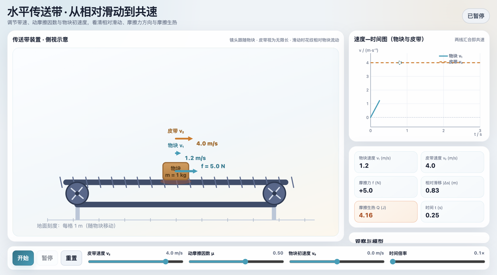
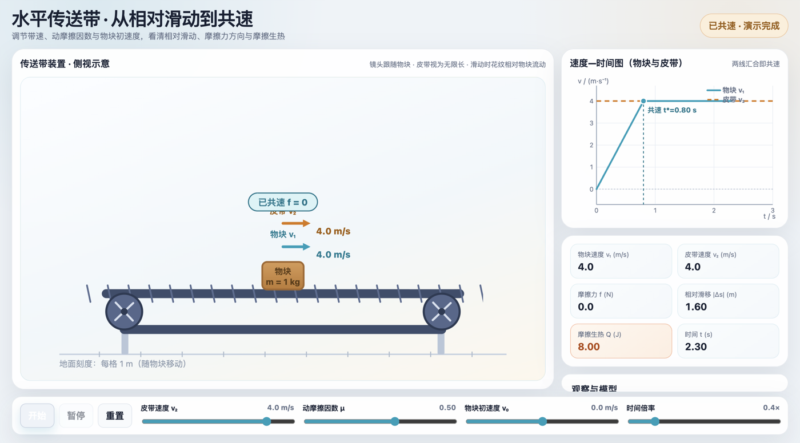
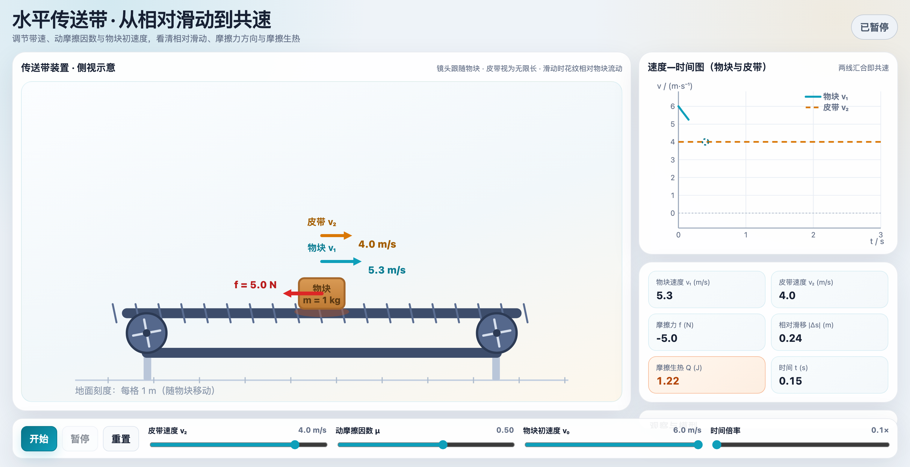
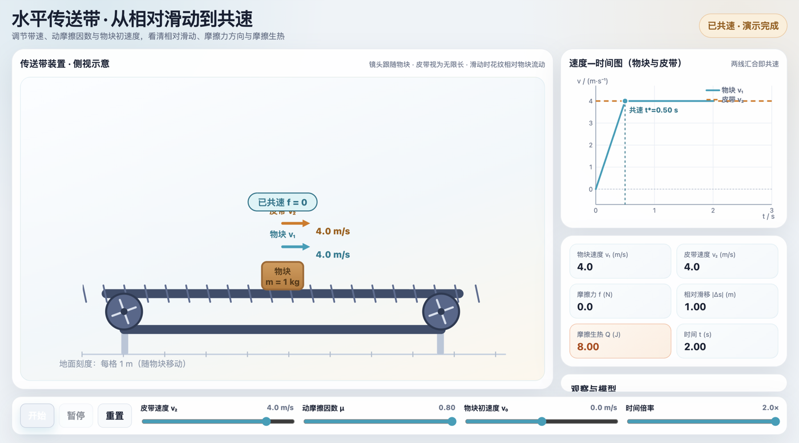

# 基于POE策略的高中"传送带"模型概念转变教学——经物理核验的AI生成交互仿真应用

**POE-Based Conceptual Change Instruction for the High-School "Conveyor-Belt" Model: An Application of AI-Generated, Physics-Verified Interactive Simulation**

作者：黄林（深圳市福海中学）
职称：未定级
联系方式：13057580075｜2664375181@qq.com

---

## 摘要

**摘要**：传送带问题是高中力学公认的难点，摩擦力方向误判与运动阶段划分断裂长期得不到根治，其根源在于迷思概念未被触动、分析依赖记忆结论。本文基于概念转变理论与POE策略，设计了以经物理核验的人工智能生成交互仿真为支撑的专题教学路径：学生先以书面预测和三色举牌显性化原有判断，再观察仿真中摩擦力箭头的出现、反转与消失、速度双线的交汇与生热的冻结，在四类参数情境的连续对比中先后经历预测落空与证据意外，依据相对运动修正判断；解释环节以两步分析法与变式检测完成概念整合。文中给出设计与概念转变条件的对应框架、完整教学预设及适用边界，为人工智能生成资源经核验进入课堂提供一条可参照的路径。

**关键词**：传送带模型；POE策略；概念转变；迷思概念；交互仿真

## Abstract

**Abstract**: Conveyor-belt problems are a widely acknowledged difficulty in senior high school mechanics: misjudgment of the direction of friction and failure to segment the motion persist despite repeated instruction, because the underlying misconceptions are left untouched and analysis leans on memorized routines. Based on conceptual change theory and the POE (Predict-Observe-Explain) strategy, this paper designs a dedicated teaching sequence supported by an interactive simulation generated by artificial intelligence to the author's requirements and verified item by item against hand calculations. Students first expose their prior judgments through written predictions and colored-card voting; they then observe, in the simulation, the friction arrow appearing, reversing and disappearing, the two velocity curves converging at co-speed, and the accumulated heat freezing at that instant. Across four parameter situations, prediction repeatedly collides with evidence, and students revise the basis of their judgment from motion to relative motion. The paper presents the mapping between the design and the conditions of conceptual change, the full instructional plan, and its boundaries of applicability, offering a referable path for bringing AI-generated resources into the classroom under a physics-verified prerequisite.

**Keywords**: POE strategy; conceptual change; misconceptions; conveyor-belt model; interactive simulation

---

## 一、问题的提出

### 1.1 传送带模型的教学难点及其概念根源

传送带模型是牛顿运动定律应用的典型拓展模型，多见于章节复习与教辅，也是考试热点。较为通行的教学处理是题型归类与例题训练，朱焱对传送带问题的归类例析代表了这类处理的基本思路[1]。归类训练能够提高熟练程度，却难以触及一个更深的事实：学生在此模型上的错误并非偶发的运算失误，而是源于系统性的迷思概念。陈欣等用四阶测试卷的诊断表明，摩擦力迷思概念在高三学生中仍普遍存在且隐蔽顽固[2]；Clement对入门力学前概念的研究也早已指出，学生将力与运动直接绑定的直觉相当顽固[3]。

具体到传送带模型，迷思概念集中于三处。其一，摩擦力方向判断。学生自初中阶段起反复接触"摩擦力阻碍运动"的表述，据此形成"摩擦力方向与运动方向相反"的判断定式；而物块无初速放上传送带时，物块相对皮带向后滑动，滑动摩擦力实际向前，判断的依据应是相对运动而非运动。其二，运动阶段划分。共速前后受力突变，学生常以同一组匀变速公式计算全程，位移与热量的结果随之出错。其三，共速条件的物理本质。不少学生能够背出"共速后随皮带一起匀速"，却无法说明水平传送带上此刻摩擦力为何为零。三类错误的共同根源，是以记忆结论替代依据条件重新分析。

### 1.2 概念转变理论与POE策略的适用性

Posner等人的概念转变理论对这类问题给出了明确判断：迷思概念不会因教师正面陈述正确结论而消失，转变的发生需要四个条件，即学习者对原有概念产生不满，新概念可以理解，显得合理，并被证明卓有成效[4]。这一论断规定了教学的形态：必须让学生亲自使用原有概念作出判断，再遭遇与之冲突的证据，而不是等待教师给出正确答案。

POE策略（Predict–Observe–Explain，预测—观察—解释）为上述条件提供了可操作的课堂结构[5]：预测环节要求学生在观察之前书面写下判断，使原有概念显性化并形成使用承诺；观察环节呈现可能与预测冲突的证据；解释环节由学生自己说明冲突何在、修正判断依据。周珏谊等以初中浮力教学为例显示了该策略在国内课堂的适用性[6]。

POE策略成立的前提，是观察环节确实能够提供可靠的证据。就传送带模型而言，这一前提恰恰难以满足：黑板图示的箭头是预先画定的结论，方向如何反转、何时消失无从观察；真实演示实验中矢量不可见、热量不可测、参数不可换。观察环节难以提供有效证据，是传送带问题在不少课堂中退化为记结论、套步骤的重要成因。

### 1.3 人工智能生成资源的机遇与物理可信度隐忧

近年来生成式人工智能工具逐渐成熟，一线教师可以按本校学情提出设计要求，获得定制的交互仿真课件，而不必依赖软件公司固化的成品。交互仿真恰好能够补上证据环节的缺口：力的反转与消失、滑移与生热的对应、参数改变下的过程重演，都是黑板与真实实验难以呈现的证据形式。

但生成资源进入课堂存在一个必须正视的隐忧：其物理内容可能出错。教研交流中画面精美而物理出错的课件并不罕见，摩擦力方向画反、能量凭空产生或消失均有所见。就概念转变教学而言，这类错误的危害超出一节课：POE教学依赖证据冲突促成转变，如果证据本身是错的，学生经历的不是认知冲突而是认知误导，损害的是对物理证据的信任。因此，人工智能生成的仿真要进入概念转变教学，须同时满足两个条件：物理上经得起逐项核验，教学上嵌入明确的认知冲突序列。

本课所用课件定位为教材配套数字资源的个性化补充，知识基础对应人教版必修第一册"运动和力的关系"牛顿运动定律应用环节[7]，能量线索衔接必修第二册的机械能[8]。本文以这节专题课为例给出完整设计，并分析其机制与边界。

## 二、教学设计与核验框架

### 2.1 设计思路：概念转变条件与教学环节的对应

本设计以概念转变四条件为骨架，以POE三环节组织课堂进程，以经物理核验的交互仿真提供证据，对应关系如表1所示。

**表1　概念转变条件、POE环节与仿真证据的对应**

| 概念转变条件 | 教学环节 | 仿真提供的证据 |
|---|---|---|
| 对原有概念产生不满 | 预测（书面判断与三色举牌）；观察情境1 | 摩擦力箭头向前（青色），与"向后"的预测直接冲突 |
| 新概念可以理解 | 观察情境2（v₀=6 m/s） | 同一"相对速度"规则解释箭头反向，正反两例归于统一 |
| 新概念显得合理 | 观察情境3（等速放上） | 无相对滑动即无滑动摩擦，水平带上且无其他水平外力时摩擦为零 |
| 新概念卓有成效 | 预测并观察情境4（只改μ） | 直觉预测两极分化，读数出人意料，须回到能量推导方能解释 |
| 概念的整合与检验 | 解释环节：两步分析法与变式检测 | 板书逐条回扣观察画面，变式迁移 |

两点说明。其一，"不满"以真实预测为前提：学生先书面表明立场，随后的冲突才归属于自己的判断，White与Gunstone强调预测环节不可顺口猜测，缘由在此[5]。其二，"卓有成效"的落实依赖情境4的不变量结构：该结论最难凭记忆应对，是全课冲突最强的一段（见3.3）。

### 2.2 课件概况与物理核验

课件为免安装、可离线使用的交互页面：左侧为传送带侧视动画，物块、皮带及两者速度矢量同屏显示；右侧为v-t双线图与实时读数面板。参数与教材惯例一致：g=10 m/s²，物块质量m=1 kg，皮带匀速且视为无限长；带速v₂、动摩擦因数μ、初速度v₀由滑块实时调节。支撑概念转变的功能有四：摩擦力箭头随相对速度变色（慢于皮带时青色向前、快于皮带时红色向后、共速瞬间消失并提示"已共速 f=0"）；物块与皮带同图的v-t双线由分离到交汇重合；生热Q与相对滑移实时显示，滑动阶段持续累积、共速瞬间冻结；三个参数滑块即时重算，同一画面内完成情境切换。

物理正确性是课件进入课堂的前提。课件内置一套数值自检，覆盖常规加速、物块快于皮带、功能关系恒等、反向进入、等速放上、皮带静止、只改摩擦因数、能量守恒、共速后生热冻结九类情形共18项，运行全部通过；笔者另对每个情境手算解析值，与课件读数逐项核对。以情境1为例，手算得加速度5 m/s²、共速时刻0.8 s、相对滑移1.6 m、摩擦生热8 J、电机做功16 J=物块动能8 J+生热8 J，与课件输出一致，功能关系恒等式的误差不足十亿分之一焦。此项核对确曾纠正过设计稿的一处预设错误（见4.3），核验由此被确立为课件进课堂的硬性前提。课件生成流程与系统化核验方法另文报告，本文聚焦课堂应用。

## 三、教学过程设计（预设）

### 3.0 教学对象与学情前设

本设计适用于学完必修第二册机械能之后的传送带专题课，高一第二学期末或高三一轮复习均可实施，1课时45分钟：导入5分钟、预测10分钟、观察20分钟、解释与检测10分钟。学生已学习牛顿运动定律、摩擦力、动能定理与功能关系。学情前设基于笔者以往几轮教学的观察：摩擦力方向误标为"向后"、认为"共速后靠摩擦力维持匀速"、全程套用单一匀变速公式，为三类常见错误。设备仅需大屏或投影并备有截图，故障时改为串讲。

### 3.1 教学目标与核心素养对标

依据《普通高中物理课程标准（2017年版2020年修订）》的核心素养要求[9]，本课目标定位如下。物理观念：深化摩擦力方向由相对运动决定的观念，建立摩擦生热对应相对滑移的能量观念。科学思维：经历比较相对速度、判断方向、划分阶段、核算能量的模型建构与推理，在质疑与检验中修正自身判断。科学探究：在预测、观察、解释中基于证据形成结论，以参数调控实现变量控制。科学态度与责任：体验预测可能出错、证据高于直觉，尊重证据、乐于修正。目标并非停留于纸面：预测全员书面作答，观察有解释性追问，变式检测全员当堂作答，课内均可检查。

### 3.2 导入与预测：让原有判断显性化

导入播放约三十秒物流分拣线视频（无条件时用图片设境）：快递箱无初速落上匀速运转的皮带。教师只问一个问题：箱子刚落上皮带的那一刻，受到的摩擦力朝哪边？不作评判，宣布本课规则：先预测、后观察，仿真当裁判。

屏幕出示情境：水平传送带v₂=4 m/s，μ=0.5，物块m=1 kg无初速轻放上皮带，仿真暂不启动。任务单三问：①画受力图并标明摩擦力方向；②同一坐标系中草绘物块与皮带的v-t图像；③推断物块最终的运动状态：它会一直加速吗？

独立作答后，以三色举牌收集第①问的判断：青色牌代表向前，红色牌代表向后，白色牌代表无摩擦，不记名，暂不公布正误。根据以往教学情况，预计持"向后"判断的学生不在少数，"摩擦力总阻碍运动"是初中阶段形成的经验认识。教师将三种判断及大致人数记于黑板一角，进入观察环节。此环节设计意图有二：预测落于书面，原有认识方能显性化，口头提问时学生容易猜测期待的答案；举牌构成当众表态，预测有误时印象更深。（若红牌寥寥，教师不强行制造对立；能量追问同样能引出冲突。）

### 3.3 观察：四段证据序列

四个观察情境的参数与理论值汇总于表2，图1至图4为对应画面。

**表2　四个观察情境的参数与理论值**（g=10 m/s²，m=1 kg）

| 情境 | v₀ (m/s) | v₂ (m/s) | μ | t* (s) | 相对滑移 (m) | 摩擦生热 Q (J) |
|---|---|---|---|---|---|---|
| 1 基础：慢于带 | 0 | 4 | 0.5 | 0.8 | 1.6 | 8 |
| 2 快于带 | 6 | 4 | 0.5 | 0.4 | 0.4 | 2 |
| 3 等速放上 | 4 | 4 | 0.5 | —（无滑动） | 0 | 0 |
| 4 只改摩擦因数 | 0 | 4 | 0.8 | 0.5 | 1.0 | 8 |

【基础观察：情境1，约8分钟】回到情境1，点击开始。学生看到：摩擦力箭头呈青色、指向前方（图1）；物块加速，v-t图上物块速度线自零起步逼近水平的皮带速度线，Q读数随滑移持续增大；至t=0.8 s两线交汇，箭头消失，面板提示"已共速 f=0"，Q冻结于8 J（图2）。教师暂不总结，连提两问：①摩擦力方向究竟由什么决定？引导学生说出"物块相对皮带向后滑，所以摩擦力向前"，将判断依据由"运动"转换为"相对运动"；②皮带走3.2 m、物块只走1.6 m，电机做的功去了哪里？答案是8 J转化为物块动能、8 J转化为热量，为能量计算铺垫。若有学生此前举红牌，可再问一句"当时错在哪一步"，请其自行说明；讨论只针对判断过程，不针对个人。此段与预测环节共同落实表1的"不满"条件：冲突指向学生自己的判断。

图 1　情境 1（v₀=0）滑动阶段：摩擦力向前（青色箭头），Q 随滑移累积（t=0.68 s 暂停帧）

图 2　情境 1 共速后：箭头消失，Q 冻结在 8 J，v-t 双线交汇重合

【对比一：物块更快，约5分钟】将v₀调至6 m/s，其余不变。箭头变为红色、指向后方（图3），物块减速，v-t线自高处下降，于t=0.4 s交汇，Q冻结于2 J。提问：传送带没有变，物块也没有变，摩擦力方向为何反转？学生运用上一问的结论即可作答：相对运动的方向反了。同一规则统一解释正反两例，判断依据随之从个案记忆转向规则本身。

图 3　情境 2（v₀=6 m/s）滑动阶段：摩擦力向后（红色箭头），物块减速，v-t 线下倾（t=0.15 s 暂停帧）

【对比二：同速放上，约3分钟】v₀=v₂=4 m/s：全程无箭头，Q恒为0，物块随皮带匀速。此情境交由学生自行解释：无相对滑动，滑动摩擦力即失去存在条件。教师追问：若物块另受水平推力？若置于斜面？为变式检测铺垫。

【对比三：只改摩擦因数，约4分钟】先预测，再观察。将μ自0.5调至0.8，其余参数不变。提问：摩擦力增大，加速更快，滑移更短，摩擦生热Q会变大还是变小？根据以往教学情况，预计学生分化为"力大则热多"与"路短则热少"两派，作出"不变"判断者预计极少；若确有学生答"不变"，则请其上台带领全班完成推导。观察：共速提前至0.5 s，滑移缩短至1.0 m，Q仍冻结于8 J（图4）。解释阶段教师带领学生推导：Q=f·s相对=μmg·s相对，而s相对=(v₂−v₀)²/(2μg)，代入得Q=½m(v₂−v₀)²，仅由质量与相对速度差决定，与μ无关，摩擦力增大与滑移缩短恰好抵消；再核算电机（此处v₀=0）：电机做功为f·s皮带=μmg·v₂·t*，代入t*=v₂/(μg)后同样与μ无关，其值恒为mv₂²=16 J=物块动能8 J+摩擦热8 J。μ改变的仅是达到共速的快慢，改变不了能量的分配方式。（前提是皮带足够长。基础较弱的班级可留待下一课时。）此处是全课冲突最强的一段：直觉预测两极分化，读数出人意料，学生必须回到推导中方能解释所见，"卓有成效"条件由此落实。

图 4　情境 4（μ=0.8）：共速提前、滑移缩短，Q 仍冻结在 8 J

四段共20分钟，节奏前慢后快：基础观察留足追问时间，后三段逐步放手，观察与解释逐步交由学生完成。

### 3.4 解释：归纳方法与变式检测

前5分钟提炼方法、复盘预测。师生共同将"传送带两步分析法"整理为一页板书：第一步，比较物块与皮带的速度，依据相对滑动方向判断摩擦力方向；第二步，以共速时刻划分阶段，共速意味着受力突变，须重新作受力分析，水平传送带且无其他水平外力时摩擦力为零，一般情形按新的受力重新求解。板书逐条回扣前述观察画面。随后回到三色牌记录，请学生对照板书复盘自身预测错在哪一环：是判断依据有误，以"运动"替代了"相对运动"，还是未在共速处重新分析。由学生自行说出错因，较教师代述更为有效。

后5分钟变式检测，小白板全员作答，两题当堂一题、课后一题：①物块以v₀=−4 m/s逆着皮带冲上传送带（v₂=4 m/s，μ=0.5，皮带足够长），判断全程摩擦力方向如何变化、物块最终如何运动（参考答案：滑动阶段方向不变，始终沿皮带运动方向；物块先减速至零，再沿皮带方向加速至共速，共速后随皮带匀速。"方向不变"正是本题考点）；②倾角θ的传送带向上匀速运行，物块随带匀速上行，摩擦力方向如何判断，两步分析法是否适用。当堂题的达标标准是能写出"先看相对速度、共速前后分开讨论"的思路；未达标者留待下节课开头复核。

## 四、分析与讨论

### 4.1 本设计的三点机制分析

第一，证据的可见性。概念冲突教学长期受制于过程不可见：摩擦力的反转与消失、滑移与生热的对应，在黑板上是结论，在真实实验中读不出来。仿真将三者变成可观察的对象，POE的观察环节由此真正成立。第二，预测的承诺效应。书面预测加举牌构成公开承诺，冲突发生时被证伪的是学生自己的判断而非教师的转述，不满由此指向自身概念，正是概念转变所要求的发生方式。第三，不变量情境的冲突强度。前两段对比仍可能以"换个结论"应付，情境4的生热不变无法靠记忆应对，冲突由表层判断进入能量框架。

### 4.2 与常规讲授及真实实验的边界

表3对比常规讲授与本设计各自所能提供的教学机制，不构成教学效果的比较。

**表3　常规讲授呈现与本设计（仿真POE）的教学机制对比**

| 对比维度 | 常规讲授呈现 | 本设计（仿真POE） |
|---|---|---|
| 力的动态过程 | 板书箭头为静态图示 | 箭头出现、反向、消失全程可见 |
| 参数调控 | 难以现场更换情境 | 滑块快速切换四类情境 |
| 定量过程数据 | 生热、滑移等过程量课上读不出来 | Q、滑移、v-t 图实时呈现 |
| 学生参与 | 听讲、答问为主 | 预设全员书面预测、全员作答 |
| 推理示范 | 教师板演，系统性强 | 依赖教师追问组织 |
| 设备要求 | 粉笔黑板即可 | 需大屏或投影，需备用方案 |
| 现场生成 | 可随学生思路即兴调整板书 | 沿预设情境序列推进 |

常规讲授的系统性、推理示范价值及对课堂现场的反应能力，为本设计所不能替代：仿真沿预设序列推进，教师须以追问组织观察，两步分析法板书仍由师生共同完成。两类方式互补，本设计补充过程证据。

仿真同样不能取代真实实验：屏幕上的物块没有重量感，Q面板的8 J没有对应的感官体验，而真实的物质经验是物理观念的基础。建议课后延伸：以小型皮带机做真实演示，皮带上撒一排粉笔灰，滑痕长度减去物块底面长即相对滑移的直接证据，课件调至同参数即可对照。学生同时接触两类证据，认识方能完整。

### 4.3 物理核验：教师不可让渡的责任

此处记录设计中的一件实事。本课设计稿最初为"增大摩擦因数"环节所写的预设结论是"滑移缩短、摩擦生热减少"，推理在"滑移变短"处中断，未考虑摩擦力同时增大的影响。按核验流程在课件中实跑μ=0.8，Q面板读数仍为8 J；再经手算复核，Q=½m(v₂−v₀)²，确实与μ无关。课件无误，设计稿最初的预设有误。此次纠错后来直接成为情境4的设计来源：教师在此处尚且容易疏漏，该问题对学生更具提问价值。由此笔者确立一条工作规程，并建议同行采纳：任何新增的参数情境，先手算理论值，再进课堂。课件呈现的是事实，但事实意味着什么，仍须经过推导检验。

在人工智能能够快速生成课件的背景下，这条规程的意义在上升：生成工具降低的是制作门槛，不降低物理责任。对一线教师而言，数智时代的新基本功体现在三件事上：将教学卡点转化为明确的设计要求，以手算守住物理正确性，在关键节点提出促使学生停顿思考的问题。三者无法由技术替代。

## 五、结语

本设计以概念转变理论为骨架、POE策略为结构、经物理核验的人工智能生成交互仿真为证据来源，给出了传送带专题教学的一条完整路径。其核心主张是：人工智能生成的仿真要进入概念转变教学，物理核验与认知冲突序列缺一不可，前者保障证据可靠，后者保障证据发挥作用。本设计目前为教学预设，尚未经受课堂实施与效果检验，拟在后续授课中以预测作答分布与变式检测成绩作前后对照，检验其有效性。其证据形式（动态矢量、实时过程量、参数对比）也不限于传送带模型，对板块、斜面等同类教学难点具有可迁移性。

**人工智能使用说明**：本文采用"作者构思、人工智能起草、作者核验定稿"的写作方式：教学设计与全部素材出自作者，课件与论文的全文初稿由人工智能工具（Claude）依据上述材料生成，作者逐段审阅修改，并复核全部物理推导与数值后定稿，文责由作者承担。**利益冲突声明**：本文无资助、无商业利益，所用课件不涉及任何商业推广。

---

## 作者简介

{width=2.5cm}

**黄林**，中山大学硕士研究生，深圳市福海中学高中物理教师。曾参与国家自然科学基金面上项目与华为校企合作项目，获多项国家专利，主持"十四五"规划 2024 年度课题。近年聚焦生成式人工智能辅助物理教学资源开发，持续制作覆盖力学、电磁学、原子物理等内容的中学物理交互仿真课件。指导学生获第二十届全国青少年未来工程师大赛一等奖、世界机器人大赛广东省一等奖。

---

## 参考文献

[1] 朱焱, 孙雯. 传送带问题的归类例析[J]. 物理教学, 2020(5): 61-65.

[2] 陈欣, 皮飞鹏, 梁文懿. 用四阶测试卷诊断高三学生摩擦力迷思概念[J]. 物理教学, 2022(3): 18-21.

[3] CLEMENT J. Students' preconceptions in introductory mechanics[J]. American Journal of Physics, 1982, 50(1): 66-71.

[4] POSNER G J, STRIKE K A, HEWSON P W, et al. Accommodation of a scientific conception: toward a theory of conceptual change[J]. Science Education, 1982, 66(2): 211-227.

[5] WHITE R, GUNSTONE R. Probing Understanding[M]. London: Falmer Press, 1992.

[6] 周珏谊, 张军朋. POE教学策略在物理教学中的应用——以"决定浮力大小的因素"为例[J]. 物理教学探讨, 2021(5): 7-9+13.

[7] 人民教育出版社课程教材研究所物理课程教材研究开发中心. 普通高中教科书·物理·必修·第一册[M]. 北京: 人民教育出版社, 2019.

[8] 人民教育出版社课程教材研究所物理课程教材研究开发中心. 普通高中教科书·物理·必修·第二册[M]. 北京: 人民教育出版社, 2019.

[9] 中华人民共和国教育部. 普通高中物理课程标准（2017年版2020年修订）[S]. 北京: 人民教育出版社, 2020.

---

